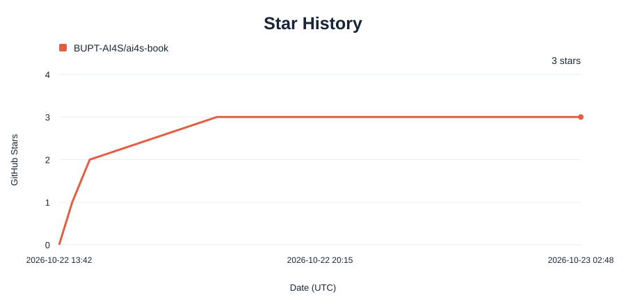

# AI for Science: Principles and Practice

**AI4SBook · 科学智能原理与实践**

[中文](README.md) | **English**

📚 **[Read online](https://bupt-ai4s.github.io/ai4s-book/)** · 🎓 **[Companion course](https://bupt-ai4s.github.io/)**

### From scientific questions to intelligent methods and reproducible experiments

**Authors: Haihong E · Kun Xu**

**Open reading · Companion course**

## About the book

Scientific intelligence requires clear scientific questions, organized knowledge, usable experimental feedback and evaluation that supports the conclusions. This book connects knowledge, action and evaluation in scientific research.

Six chapters connect scientific data, knowledge modeling, foundation-model pretraining, scientific agents, trustworthy evaluation and autonomous laboratories, with 64 figures, 13 tables and research examples.

## Contents

| Chapter | Focus | Access |
| --- | --- | --- |
| 1. 科学数据与AI4S研究闭环 | Scientific data governance, organization, representation and research workflows | [Read](https://bupt-ai4s.github.io/ai4s-book/read.html?chapter=ch06-scientific-data) · [PDF preview](https://bupt-ai4s.github.io/ai4s-book/read.html?chapter=ch06-scientific-data&view=pdf) |
| 2. 科学知识建模与大模型推理 | Knowledge representation, retrieval augmentation and large-model reasoning | [Read](https://bupt-ai4s.github.io/ai4s-book/read.html?chapter=ch13-knowledge-rag) · [PDF preview](https://bupt-ai4s.github.io/ai4s-book/read.html?chapter=ch13-knowledge-rag&view=pdf) |
| 3. 科学基础模型的预训练原理与方法 | Pretraining objectives, methods and scientific applications | [Read](https://bupt-ai4s.github.io/ai4s-book/read.html?chapter=ch04-pretraining) · [PDF preview](https://bupt-ai4s.github.io/ai4s-book/read.html?chapter=ch04-pretraining&view=pdf) |
| 4. 科学智能体：从基本概念到科研应用与研究版图 | Agent architectures, scientific workflows and applications | [Read](https://bupt-ai4s.github.io/ai4s-book/read.html?chapter=ch05-scientific-agents) · [PDF preview](https://bupt-ai4s.github.io/ai4s-book/read.html?chapter=ch05-scientific-agents&view=pdf) |
| 5. 科学智能的测评数据构建与可信评价 | Evaluation data, metrics and credible conclusions | [Read](https://bupt-ai4s.github.io/ai4s-book/read.html?chapter=ch03-evaluation) · [PDF preview](https://bupt-ai4s.github.io/ai4s-book/read.html?chapter=ch03-evaluation&view=pdf) |
| 6. 自主实验室与干湿闭环 | Computational decisions, experiments and measurement feedback | [Read](https://bupt-ai4s.github.io/ai4s-book/read.html?chapter=ch16-autonomous-laboratory) · [PDF preview](https://bupt-ai4s.github.io/ai4s-book/read.html?chapter=ch16-autonomous-laboratory&view=pdf) |

Read in order to connect the full research workflow, or choose chapters by research interest.

## Audience and reading guide

The book is intended for advanced science and engineering undergraduates, graduate students and interdisciplinary researchers. Basic mathematics, statistics, machine learning concepts and Python reading skills are useful. Chapters 1–3 establish the data, knowledge and model foundations; Chapters 4–6 connect scientific agents, trustworthy evaluation and experimental feedback.

The book is in **Chinese**, with bilingual project information and website navigation.

## Reading and resources

- [Read online](https://bupt-ai4s.github.io/ai4s-book/) with chapter navigation, figures, formulas and references. Switch to PDF preview for original page layouts, continuous scrolling, page navigation, zoom and clickable citations with a return to the reading position.
- The [companion course](https://bupt-ai4s.github.io/) provides teaching materials, recordings and further reading.

## Feedback and contributions

Use [Issues](https://github.com/BUPT-AI4S/ai4s-book/issues/new/choose) to report text, formula, figure, reference or website issues. Include the chapter/section, a description, suggested changes and supporting sources where available.

See [CONTRIBUTING.md](CONTRIBUTING.md) for participation details.

## Chapter contributors

| Chapter | Contributors |
| --- | --- |
| Chapter 1 | 王梦冉 |
| Chapter 2 | 王婉婷和李雪婷 |
| Chapter 3 | 朱长昊和乔徐阳 |
| Chapter 4 | 陈晨和丁利军 |
| Chapter 5 | 胡心怡 |
| Chapter 6 | 黄怡玲 |

Cover image: created with AI assistance by 汤子辰.

## Teaching and usage authorization

Institutions wishing to use this book as a textbook, for courses, training or other purposes should contact the authors by email to obtain authorization.

**Contact: [ehaihong@bupt.edu.cn](mailto:ehaihong@bupt.edu.cn)**

## Citation and rights

Please cite the book title, authors, year and project URL. The full citation example is in the [Chinese README](README.md); machine-readable metadata is in [CITATION.cff](CITATION.cff).

The book is available to read online. Copyright belongs to the respective rights holders. For redistribution, adaptation or commercial use, contact the authors by email. Third-party sources and licenses are listed in the chapters and components. See [RIGHTS.md](RIGHTS.md).

If the book is useful to you, consider starring the repository to find it again and follow updates.

## Reasoning Lab

Scan the QR code to follow **Reasoning Lab**.

## Star History

If the book is useful to you, give it a **Star ⭐**. The chart below uses this repository's GitHub star data and updates daily.

<a href="https://github.com/BUPT-AI4S/ai4s-book/stargazers">
<picture>
  <source media="(prefers-color-scheme: dark)" srcset="static/images/star-history-dark.svg">
  <source media="(prefers-color-scheme: light)" srcset="static/images/star-history-light.svg">
  
</picture>
</a>
